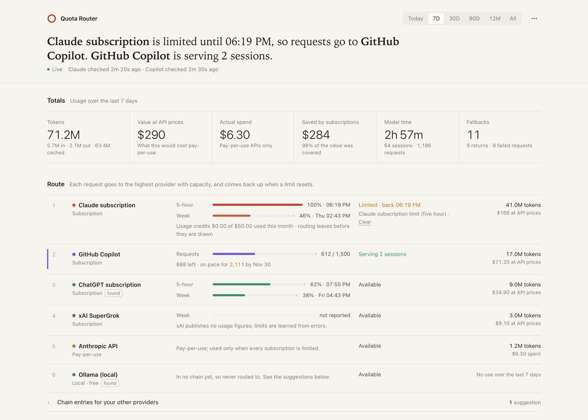

# quota-router: automatic model fallback for OpenCode when you hit a usage limit

[](https://github.com/aicowboi/opencode-quota-router/actions/workflows/ci.yml)
[](LICENSE)

**Hit your Claude 5-hour limit, your ChatGPT weekly limit or your Copilot allowance in the middle of a task? quota-router keeps the session going on another provider, then moves it back when the limit resets.**

It's an [OpenCode](https://opencode.ai) plugin that routes each request to the best provider you have capacity on. It knows how each plan's limits work, so it can see a limit coming instead of only reacting to errors. It also shows a local dashboard of usage, cost and fallbacks.



<sub>Dashboard with demo data.</sub>

## Why

Coding agents burn through subscription limits quickly. Without help, a limit means one of three things: a failed turn, OpenCode retrying for up to 15 minutes, or you switching models by hand and remembering to switch back. If you pay for several plans (Claude, ChatGPT, Copilot, SuperGrok) and some API keys, the capacity is there; it just isn't used in a sensible order.

quota-router uses it in this order:

- **Subscriptions first.** Claude, ChatGPT, Copilot and Grok plans are used before pay-per-use API keys. Local models (Ollama, LM Studio, vLLM) come last, at no cost.
- **Same request, new provider.** On a limit, the failed request is re-run on the equivalent model elsewhere, keeping its effort level, with no lost tool calls or extra messages.
- **Back up when the limit resets.** It reads exact reset times from Claude, ChatGPT, Copilot, Anthropic and OpenAI, so it neither retries too early nor waits forever.
- **Sees limits coming (optional).** It reads your Claude 5-hour and weekly windows, your ChatGPT windows and your Copilot credits, and moves off a plan before it runs out.
- **No surprise charges (optional).** It leaves Claude before usage credits are drawn, and Copilot before paid credits beyond your allowance.
- **Works with every provider OpenCode connects.** New connections are found automatically, and the dashboard suggests where each fits.
- **Local only.** No telemetry and no server of its own. Your data stays in a SQLite file on your machine. See [SECURITY.md](SECURITY.md).

> Unofficial. Not affiliated with Anthropic, GitHub, xAI, OpenAI or OpenCode.

## Contents

- [Requirements](#requirements)
- [Quick start](#quick-start)
- [Onboarding guide](#onboarding-guide)
- [How routing works](#how-routing-works)
- [Dashboard and menu bar](#dashboard-and-menu-bar)
- [Commands](#commands)
- [Configuration reference](#configuration-reference)
- [Errors it handles](#errors-it-handles)
- [FAQ](#faq)
- [Troubleshooting](#troubleshooting)
- [Development](#development)

## Requirements

- **OpenCode V2**, 2.2 or later. The menu bar item needs OpenCode Desktop.
- **Node.js 24 or later and npm**, only to install and build.
- **At least two OpenCode providers connected**, for example a Claude subscription and an API key.

## Quick start

```bash
git clone https://github.com/aicowboi/opencode-quota-router.git
cd opencode-quota-router
npm install --ignore-scripts
npm run build          # builds the menu bar part (dist/gui-experimental.cjs)
```

Add the plugin to your global OpenCode config, `~/.config/opencode/opencode.jsonc`:

```jsonc
{
  "$schema": "https://opencode.ai/config.json",
  "plugins": [
    { "package": "/absolute/path/to/opencode-quota-router", "options": {} }
  ]
}
```

OpenCode loads it straight away; there's nothing to restart. Run `/router` in any session to open the dashboard.

## Onboarding guide

### 1. Connect your providers

quota-router only routes between providers that OpenCode can already use. In OpenCode, run `/connect` for each provider you have. Its default chains cover these five:

| Priority | Provider ID | What it is |
|---|---|---|
| 1 | `claude-agent` | Claude Pro, Max, Team or Enterprise, via the Claude Code login |
| 2 | `xai` | SuperGrok or X subscription (signed in), or an xAI API key (pay-per-use) |
| 3 | `github-copilot` | GitHub Copilot |
| 4 | `anthropic` | Anthropic API key (pay-per-use) |
| 5 | `openai` | OpenAI API key (pay-per-use), or a ChatGPT plan when you sign in with ChatGPT |

Providers you haven't connected are skipped, so you don't need all five.

**Every other provider** OpenCode connects (Ollama, LM Studio, OpenRouter, Gemini, Bedrock, Vertex, Azure, Fireworks, Groq and the rest) is found automatically and given a kind from how you connected it:

- **Subscription:** signed in with a plan (for example ChatGPT or Ollama Cloud).
- **Pay-per-use:** an API key.
- **Local:** Ollama, LM Studio, vLLM and similar. These are free, so they cost nothing on the dashboard.

Found providers rank after the ones you configured: subscriptions first, then pay-per-use, then local. They're only routed to once they're in a chain (step 3). Set `"discovery": { "enabled": false }` to rank only the providers you list.

**ChatGPT plans.** If you sign in to OpenAI with ChatGPT (Plus, Pro, Business), it's treated as a subscription and ranked with the others. Its 5-hour and weekly windows appear on the dashboard after its first response, and routing leaves it at 98% so you never hit the wall mid-task. If a limit is hit anyway, the exact reset time from ChatGPT is used. An OpenAI API key is unaffected.

### 2. Choose your order

Lower numbers are tried first. To put Copilot ahead of xAI, for example:

```jsonc
"options": {
  "providers": { "github-copilot": { "priority": 2 }, "xai": { "priority": 3 } }
}
```

Set `"allow": "never"` on a provider to keep it out of routing completely.

### 3. Pick a model that belongs to a chain

A **chain** lists the equivalent models across providers. Selecting any model in a chain puts the session under routing. The defaults use Claude Opus 5.5 at medium effort as the reference model:

| Chain | Claude subscription | xAI | Copilot | Anthropic API | OpenAI API |
|---|---|---|---|---|---|
| `opus` | `opus#medium` | `grok-4.7#high` | `claude-opus-5.5#medium` | `claude-opus-5-5#medium` | `gpt-6.1-sol#high` |
| `sonnet` | `sonnet#medium` | `grok-4.7#medium` | `claude-sonnet-5.5#medium` | `claude-sonnet-5-5#medium` | `gpt-6.1-sol#medium` |
| `fable` | `fable#medium` | `grok-4.7#xhigh` | — | `claude-fable-5-1#medium` | `gpt-6-astra#medium` |
| `haiku` | `haiku#medium` | `grok-build-0.1` | `claude-haiku-5.5#medium` | `claude-haiku-5-5#medium` | `gpt-6-luna#medium` |

- **New sessions:** to route these by default, set your default model to a chain member, for example `"model": "claude-agent/opus"`.
- **Models outside every chain** are never touched.
- **Other providers:** the dashboard's Route section lists suggested entries for every connected provider that's in no chain yet: the same model family where there is one, otherwise the model nearest the chain's price level. **Add** puts it in the chain; **Ignore** hides it. Your choices are stored by the plugin, not in your config.

**Choosing your own models.** Change one provider's entry and keep the rest of the chain:

```jsonc
"chains": {
  "opus": { "xai": "grok-4.6#high", "openai": null, "ollama": "qwen3-coder" }
}
```

A model name sets that provider's entry, `null` removes it, and a provider not yet in the chain is added. To replace a chain completely, or to make your own, give a list: `"chains": { "gpt": ["openai/gpt-6.1-sol#high", "azure/gpt-6.1-sol#high"] }`. `"opus": null` removes a chain.

To make a model other than Opus your first choice, give its provider the lowest priority: routing always tries providers in priority order within the chain.

Effort carries across providers as an offset: Opus at `high`, one step above its `medium` baseline, becomes Grok at `xhigh`. A model is skipped if the conversation wouldn't fit its context window.

### 4. Optional: turn on the usage checks

Without these, quota-router reacts to limit errors. With them, it sees limits coming. Each is **off by default** because it reads a local login and calls an unofficial endpoint (details in [SECURITY.md](SECURITY.md)):

```jsonc
"options": {
  "claude": { "usageProbe": true },
  "copilot": { "usageProbe": true }
}
```

- **Claude:** reads Claude Code's login from the macOS keychain (or `~/.claude/.credentials.json`) and checks your 5-hour and weekly windows, the same figures Claude Code's `/usage` shows. Routing leaves the subscription when a window reaches 98%, or as soon as usage credits start going up. The login is never stored, logged or refreshed.
- **Copilot:** uses OpenCode's stored GitHub login to read your monthly allowance, and stops routing to Copilot before paid credits beyond it are used. Business and Enterprise seats share credits across the organisation, so your seat's share is used (1,900 or 3,900 a month); set `copilot.monthlyCredits` if yours differs.

### 5. Check it's working

1. Run `/router`. The dashboard opens at `http://127.0.0.1:47321`.
2. In **Route**, your connected providers appear in your order, and the one serving your session is marked.
3. Send a message, and it appears under **Running now**, then in the totals.
4. Problems are written to `~/.local/share/opencode-quota-router/router.log`.

## How routing works

- **Within a turn.** A failed request is classified as a throttle, overload, window used up, billing problem or auth failure.
  - Short throttles (a `retry-after` of 20 s or less) retry on the same provider.
  - Anything else switches the session to the next provider inside OpenCode's retry hook. The same request runs again there, with no extra messages and no lost tool calls.
- **At the next turn.** The session moves to the highest-priority provider that's available, so it returns once a limit resets.
- **Health is per pool and shared.** A pool is something that can run out: the Claude subscription, its per-model weekly limits, or an API key. Every session shares that health, and it survives restarts.
- **Reset times** come from the provider wherever possible: Claude's limit message, Copilot's `Retry-After`, Anthropic's monthly spend cap and rate-limit headers. Otherwise a backing-off cooldown applies, and the provider is retried at a turn boundary.
- **When everything is limited,** the request waits for the earliest reset, up to 30 minutes per retry. A failed session is continued once at that reset, if nothing else happened in it.
- **Your choice of model** sets the chain and effort level. Routing still uses the highest-priority provider with capacity; use `/router pin` to keep one session on one provider.

## Dashboard and menu bar

**Dashboard:** `http://127.0.0.1:47321` while OpenCode runs, or `/router`. Local only. It shows:
- totals (tokens, value at API prices, actual spend, savings, model time, fallbacks);
- the route, with each provider's live state and allowances;
- running sessions;
- a routing log grouped by day;
- usage charts, breakdowns by model, project, agent and tool, and searchable sessions;
- CSV export.

**Menu bar** (OpenCode Desktop only): a ring showing Claude's 5-hour window, with short status text. Its menu shows allowances, the route, running sessions, today's totals and quick actions. Turn it off with `"dashboard": { "menubar": false }`.

**Data:** `~/.local/share/opencode-quota-router/router.db` (SQLite) holds daily rollups, cached session totals and retention settings, sized for years of use. On first start, earlier usage is imported read-only from OpenCode's own database.

## Commands

| Command | Effect |
|---|---|
| `/router` | Open the dashboard |
| `/router pin` | Keep this session on its current model |
| `/router unpin` | Route this session again |
| `/router reset <pool or all>` | Clear a provider's limited state |
| `/router pause` | Pause routing for every session |
| `/router resume` | Resume routing for every session |

## Configuration reference

All options go under the plugin's `options` in `opencode.jsonc`. Defaults are in [`src/config.ts`](src/config.ts).

| Option | Default | Meaning |
|---|---|---|
| `providers.<id>.priority` | 1–5 as above | Lower is tried first. Chains are sorted by it. |
| `providers.<id>.allow` | `always` | `never` keeps a provider out of routing |
| `chains.<name>` | see above | A list of `provider/model#variant` replaces the chain; an object of `provider: model` (or `null`) changes single entries; `null` removes the chain |
| `providers.<id>.kind` | detected | `subscription`, `metered` or `local`; set it to override what discovery detects |
| `discovery.enabled` | true | Rank and show every connected provider, not only the ones listed here |
| `chatgpt.cutoverAtPct` / `warnAtPct` | 98 / 85 | Leave a ChatGPT plan before its 5-hour or weekly window is spent |
| `throttle.maxWaitMs` / `inPlaceRetries` | 20000 / 2 | Short throttles retried on the same provider |
| `onExhausted.mode` / `maxWaitMs` | `wait` / 30 min | When everything is limited: wait for the earliest reset, or `fail` |
| `claude.usageProbe` | false | Check Claude subscription usage (see step 4) |
| `claude.avoidUsageCredits` / `cutoverAtPct` | true / 98 | Leave the subscription before usage credits are drawn |
| `copilot.usageProbe` | false | Check Copilot's monthly allowance (see step 4) |
| `copilot.avoidAdditionalCredits` / `reserveFraction` | true / 0.01 | Leave Copilot before paid credits beyond the allowance |
| `copilot.monthlyCredits` | 0 (plan default) | Your included credits on a pooled Business or Enterprise seat |
| `headers.observe` | anthropic, github-copilot | Providers whose rate-limit headers are read. Adding `openai` or `xai` turns off their WebSocket transport. |
| `dashboard.enabled` / `port` / `menubar` | true / 47321 / true | Local dashboard and menu bar item |
| `backfill` | true | Import earlier OpenCode usage on first start |
| `retention.toolsDays` / `executionsDays` / `snapshotsDays` / `poolLogDays` | 400 / 400 / 90 / 730 | Days of raw detail kept; rollups and requests are kept for good |
| `log.level` | `info` | `debug` logs every retry decision |

## Errors it handles

If you searched for one of these, this plugin is for you. Each is recognised, given a reset time where the provider reports one, and routed around.

| Provider | Error or message | What quota-router does |
|---|---|---|
| Claude subscription (Pro, Max, Team) | `Claude AI usage limit reached`, `You've hit your session limit · resets 3:45pm`, `You've hit your weekly limit`, `Opus limit reached` | Moves to the next provider until the stated reset; a per-model weekly limit only blocks that model family |
| Claude subscription | Usage credits being drawn after the window ends | Moves off before credits are used (with `claude.usageProbe`) |
| ChatGPT plan (Plus, Pro, Business) | `usage_limit_reached`, "The usage limit has been reached" | Moves on until `resets_at`; with ChatGPT signed in, leaves at 98% of the 5-hour or weekly window |
| GitHub Copilot | `quota_exceeded`, "You have exceeded your monthly quota", premium requests or AI credits used up | Moves on until the monthly reset; can stop before paid credits beyond the allowance |
| xAI / SuperGrok | "You have used all available credits", spending limit reached | Moves on and retries after a cooldown |
| Anthropic API | `rate_limit_error` (429), `overloaded_error` (529), "Your credit balance is too low", monthly spend cap ("You will regain access on …") | Short throttles retry in place; the rest move on, a spend cap until the 1st of the month |
| OpenAI API | `insufficient_quota`, "You exceeded your current quota", `server_is_overloaded` | Moves on; a monthly limit until the 1st |
| Any provider | HTTP 429, 402, 5xx, timeouts, OpenCode's `provider.rate-limit` and `provider.quota` errors | Classified as throttle, overload, window or billing, and handled the same way |

Errors that a different model wouldn't fix (content filters, invalid requests, context too long, permission denials) are never routed.

## FAQ

**How do I keep working in OpenCode when Claude hits its 5-hour limit?**
Install quota-router and connect at least one other provider: Copilot, ChatGPT, an API key or a local model. When Claude reports the limit, the same request runs on the next provider, and the session moves back to Claude after the reset time Claude gave.

**Does it work with Claude Code, Codex or Cursor?**
No. It's an OpenCode plugin and uses OpenCode's retry and routing hooks. It does use your Claude subscription through OpenCode's Claude provider, and your ChatGPT plan through "Sign in with ChatGPT".

**Will it spend money without asking?**
Only on providers you've connected with an API key, and only when every subscription ahead of them is limited. Set `"allow": "never"` on a provider to keep it out. The dashboard shows actual spend separately from the value of your subscription use.

**Can I use a local model as the last resort?**
Yes. Connect Ollama, LM Studio or vLLM in OpenCode, then add the suggested entry on the dashboard or set it in `chains`. Local models rank last and count as free.

**Can I prefer GPT, Gemini or Grok instead of Claude?**
Yes. Give that provider the lowest `priority`, and change any chain entry with `"chains": { "opus": { "<provider>": "<model>" } }`.

**How is this different from opencode-rate-limit-fallback?**
[opencode-rate-limit-fallback](https://github.com/azumag/opencode-rate-limit-fallback) is a well-established general fallback list with retry policies and a circuit breaker. quota-router is built around subscription plans. It reads plan usage and exact reset times to move before a limit and back after it, keeps effort levels across providers, avoids paid overage, and adds a usage and cost dashboard. Pick the one that matches how you pay for models.

**Does it send my data anywhere?**
No. Everything stays on your machine. The optional usage checks call the same endpoints Claude Code and Copilot use, with logins that are already on your machine; see [SECURITY.md](SECURITY.md).

## Troubleshooting

- **The dashboard doesn't open.** Check `router.log` for `dashboard` lines. If port 47321 is taken, the next free port up to 47325 is used, and `/router` opens the right one.
- **A session isn't routed.** Its model isn't in any chain. Pick a chain model, or add yours to `chains`.
- **A connected provider is never used.** It's in no chain yet. Add one of its suggested entries on the dashboard, or set it in `chains`.
- **"Usage check" messages on the dashboard.** The Claude check needs Claude Code to be logged in (`claude auth login`). An expired login refreshes the next time Claude Code runs.
- **The menu bar item doesn't appear.** It needs OpenCode Desktop and a built `dist/gui-experimental.cjs` (`npm run build`). After first adding it, restart OpenCode once.
- **Routing misbehaves.** Run `/router pause`, or use the dashboard's pause button, and open an issue with the relevant `router.log` lines. Remove anything private from them first.

## Development

```bash
npm install --ignore-scripts
npm test           # unit, harness and storage tests (Node 24, built-in SQLite)
npm run typecheck
npm run build      # menu bar bundle
```

- **Dashboard:** `src/dashboard/page.html`, read on every request.
- **Server code:** changes rebuild the plugin's core when saved, with no restart.
- **`package.json` exports:** changes need an OpenCode restart.

## How it's built

See [docs/how-it-works.md](docs/how-it-works.md) for the design: the error classifier, per-pool health shared across sessions, the router, the usage checks and the storage that keeps years of history small.

## License

[MIT](LICENSE)
