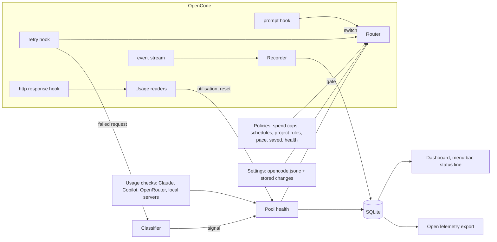

# How quota-router works

quota-router is an OpenCode V2 plugin. It never proxies traffic. It decides which model a session should use and tells OpenCode, through the hooks OpenCode gives plugins.

## The parts

**The engine** (`src/engine/`) is pure: no I/O, no `process`, no `fetch`, and nothing imported from outside the folder (a test enforces it). It is exported as `opencode-quota-router/engine` so other tools can use it, and the LiteLLM callback is a port of its classifier.

| File | Job |
|---|---|
| `classify.ts` | Turns a failed request into a signal: what ran out (`throttle`, `overload`, `window`, `billing` or `auth`), for which pool, and until when. Provider-specific wording and codes are checked first, then OpenCode's error type, then the HTTP status. |
| `resets.ts` | Reads reset times in every format providers use: ISO dates, epoch seconds, `resets 3:45pm`, `resets Mon 12:00am`, `retry-after`, Go durations such as `6m0s`, waits given in words, midnight in a provider's time zone, and "regain access on" dates. |
| `pools.ts` | Health per *pool*: the thing that actually runs out. The Claude subscription is one pool, with a sub-pool per model family for weekly limits; each API key is another; Gemini, Vertex, Bedrock, Azure and OpenRouter limit each model on its own. Pools are `available`, `degraded`, `cooling` or `blocked`, back off on repeated failures, and turn half-open once their deadline passes. Every session shares this state, and it survives restarts. |
| `router.ts` | Given the chain for the session's model, provider priorities, pool health, a gate and the conversation size, it returns the best model now, or the earliest moment one frees up. Effort carries across as an offset: Opus at `high`, one step above its baseline, becomes Grok at `xhigh`. |
| `policy.ts` | Reasons to pass over an entry that have nothing to do with pool health. Each policy is a pure function that returns a block, with a reason and an end time; `soft` blocks rank an entry below every usable one instead of skipping it. |
| `rules.ts`, `schedule.ts` | Project rules (which providers and chain a project's sessions use) and schedules (rules that apply at certain times, in local time). |
| `health.ts`, `forecast.ts`, `learn.ts` | Latency and error rate per provider; when a plan window will run out at its current pace; the size of a pool that publishes no figures (xAI), learned from the times it ran out, or estimated from a console reading until then. |
| `plans.ts`, `pricing.ts` | Subscription plans and advice on whether each fits; value at API list price and actual spend. |
| `discovery.ts` | Finds every connected provider, labels it subscription, pay-per-use or local from how it was connected, ranks the unconfigured ones, and suggests chain entries by model family or price level, including newer models of the same line. |
| `config.ts` | Defaults, parsing and checks for every option, and the overlay of stored settings on top of `opencode.jsonc`. |

**Around the engine:**

| File | Job |
|---|---|
| `src/core.ts` | The process-wide state: settings, pools, the policies composed into one gate, probes, the store. |
| `src/controller.ts` | Wires the router to OpenCode. The **retry hook** moves a failed request to the next provider and re-runs it straight away. The **prompt hook** moves a session back up at the start of a turn once a limit has reset, or ahead of one when a usage check says a plan is nearly spent. Short throttles retry in place. |
| `src/probes/*`, `src/engine/headers.ts` | Optional usage readers: Claude's 5-hour and weekly windows, Copilot's monthly credits, OpenRouter's key limit, whether Ollama or LM Studio is running, ChatGPT's `x-codex-*` headers and standard rate-limit headers. They let routing leave a plan *before* it fails. |
| `src/recorder.ts`, `src/db.ts`, `src/maintenance.ts` | Record every request from OpenCode's event stream into SQLite, with token counts, value at API prices and actual spend. |
| `src/dashboard/` | A local-only HTTP server and a single HTML page with live updates over server-sent events, including the settings page. Writes need a JSON `POST` from the page itself; settings also need a per-process token. |
| `src/tui.tsx`, `src/status.ts` | The terminal part: notifications as toasts, and the status line in the prompt footer, from the dashboard's `/api/status` feed. |
| `src/cli/` | The `quota-router` command. Its readers parse Claude Code, Codex and OpenCode logs incrementally, read-only, with a private cache; it's built into one file, `dist/cli.mjs`. |
| `src/telemetry/` | The optional OpenTelemetry export (OTLP over HTTP/JSON). |
| `src/doctor.ts`, `src/alerts.ts`, `src/advisor.ts` | The health check, notifications, and plan advice. |
| `gui/` | The macOS menu bar item, built for OpenCode Desktop. |
| `integrations/` | The LiteLLM callback (Python) and the Claude Code Router routing rule. |

## Design choices

**Fail over inside the retry hook, not by resending.** Many fallback plugins abort the turn and resend the last message. quota-router instead switches the model in OpenCode's retry hook and asks for an immediate retry, so the same request runs again with its tool calls intact.

**Prefer priority over the model you picked.** Your choice of model sets the chain and the effort level, and routing always uses the best provider with capacity. A session drifts back to your top subscription once it resets. `/router pin` opts a session out, and the subagents it starts with it: a pin is a deliberate choice of provider, so routing their work to the top of the chain would undo it.

**Never route deterministic errors.** Content filters, invalid requests and context overflows would fail the same way anywhere, so switching models would only hide them.

**Shared, persistent pool state.** Many sessions share one plan. When one session learns that Claude's weekly Opus limit is spent until Monday, every session knows, including after a restart.

**Policies are a gate, not a rewrite.** Spend caps, schedules, project rules, the pace guard and "save for later" don't edit chains. Each one only says whether an entry may be used now, and the router picks among what's left. That keeps them independent and testable, and the dashboard can say exactly why an entry was passed over.

**Your config file is never written.** Settings changed from a command or the dashboard are stored by the plugin and laid over `opencode.jsonc`, each checked first. Where the dashboard listens, where telemetry goes and the local server addresses can only be set in the file, so nothing that can reach the dashboard can redirect data.

**One process-wide core.** OpenCode loads the plugin once per project. A single core, keyed on a global symbol, holds pools, the database and the dashboard listener. A fingerprint of the source rebuilds it when the code changes, without dropping the dashboard's port.

## Storage that scales to years

Raw requests are kept for good, and everything the dashboard reads comes from small summary tables:

- `daily_usage` and `daily_tools` hold one row per day for each provider, model, project, agent and kind. Writes mark the day as dirty, and a background step re-aggregates only the dirty days.
- Session totals are cached on the session row and refreshed the same way.
- Detail tables (tool calls, executions, usage snapshots and the pool log) have their own retention, which you can configure, and the database is optimised once a day.

So a range of "all time" reads a few thousand rows, however long you've used it.

## Testing

`npm test` runs unit tests for the classifier, reset parsing, pools, router, policies, pricing, discovery, storage and the command line, a harness that drives the hooks and the dashboard the way OpenCode does, and contract tests against the pinned OpenCode plugin API. `python3 -m unittest discover -s integrations/litellm` checks the LiteLLM port against the same classifier cases. Every fixture is invented. CI runs the type check, the build and all of these on Linux and macOS for every push; [support.md](support.md) lists what is tested where.
