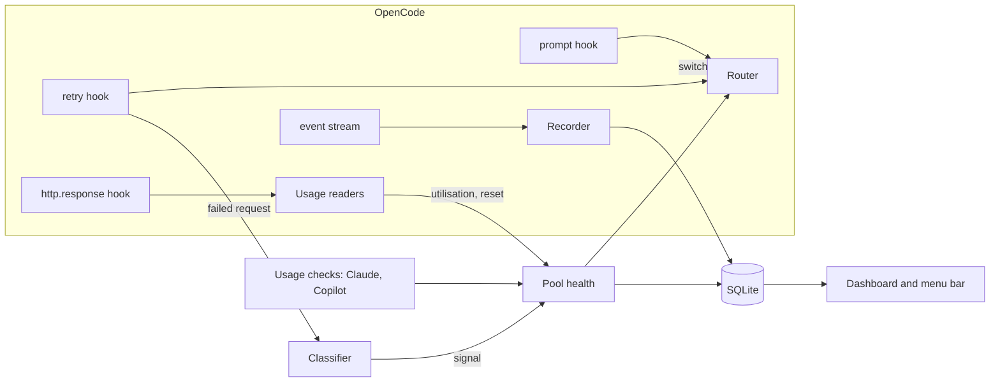

# How quota-router works

quota-router is an OpenCode V2 plugin. It never proxies traffic. It decides which model a session should use and tells OpenCode, through the hooks OpenCode gives plugins.

## The parts

| File | Job |
|---|---|
| `src/classify.ts` | Turns a failed request into a signal: what ran out (`throttle`, `overload`, `window`, `billing` or `auth`), for which pool, and until when. Provider-specific wording and codes are checked first, then OpenCode's error type, then the HTTP status. |
| `src/resets.ts` | Reads reset times in every format providers use: ISO dates, epoch seconds, `resets 3:45pm`, `resets Mon 12:00am`, `retry-after`, Go durations such as `6m0s`, and "regain access on" dates. |
| `src/pools.ts` | Health per *pool*: the thing that actually runs out. The Claude subscription is one pool, with a sub-pool per model family for weekly limits; each API key is another. Pools are `available`, `degraded`, `cooling` or `blocked`, back off on repeated failures, and turn half-open once their deadline passes. Every session shares this state, and it survives restarts. |
| `src/router.ts` | A pure function. Given the chain for the session's model, provider priorities, pool health and the conversation size, it returns the best model now, or the earliest moment one frees up. Effort carries across as an offset: Opus at `high`, one step above its baseline, becomes Grok at `xhigh`. |
| `src/controller.ts` | Wires the router to OpenCode. The **retry hook** moves a failed request to the next provider and re-runs it straight away. The **prompt hook** moves a session back up at the start of a turn once a limit has reset. Short throttles retry in place. |
| `src/probes/*`, `src/headers.ts` | Optional usage readers: Claude's 5-hour and weekly windows, Copilot's monthly credits, ChatGPT's `x-codex-*` headers and standard rate-limit headers. They let routing leave a plan *before* it fails. |
| `src/discovery.ts` | Finds every connected provider, labels it subscription, pay-per-use or local from how it was connected, ranks the unconfigured ones, and suggests chain entries by model family or price level. |
| `src/recorder.ts`, `src/db.ts`, `src/maintenance.ts` | Record every request from OpenCode's event stream into SQLite, with token counts, value at API prices and actual spend. |
| `src/dashboard/` | A local-only HTTP server and a single HTML page, with live updates over server-sent events. |
| `gui/` | The macOS menu bar item, built for OpenCode Desktop. |

## Design choices

**Fail over inside the retry hook, not by resending.** Many fallback plugins abort the turn and resend the last message. quota-router instead switches the model in OpenCode's retry hook and asks for an immediate retry, so the same request runs again with its tool calls intact.

**Prefer priority over the model you picked.** Your choice of model sets the chain and the effort level, and routing always uses the best provider with capacity. A session drifts back to your top subscription once it resets. `/router pin` opts a session out.

**Never route deterministic errors.** Content filters, invalid requests and context overflows would fail the same way anywhere, so switching models would only hide them.

**Shared, persistent pool state.** Many sessions share one plan. When one session learns that Claude's weekly Opus limit is spent until Monday, every session knows, including after a restart.

**One process-wide core.** OpenCode loads the plugin once per project. A single core, keyed on a global symbol, holds pools, the database and the dashboard listener. A fingerprint of the source rebuilds it when the code changes, without dropping the dashboard's port.

## Storage that scales to years

Raw requests are kept for good, and everything the dashboard reads comes from small summary tables:

- `daily_usage` and `daily_tools` hold one row per day for each provider, model, project, agent and kind. Writes mark the day as dirty, and a background step re-aggregates only the dirty days.
- Session totals are cached on the session row and refreshed the same way.
- Detail tables (tool calls, executions, usage snapshots and the pool log) have their own retention, which you can configure, and the database is optimised once a day.

So a range of "all time" reads a few thousand rows, however long you've used it.

## Testing

`npm test` runs unit tests for the classifier, reset parsing, pools, router, pricing, discovery and storage, plus a harness that drives the hooks the way OpenCode does. CI runs typecheck, tests and the build on every push.
